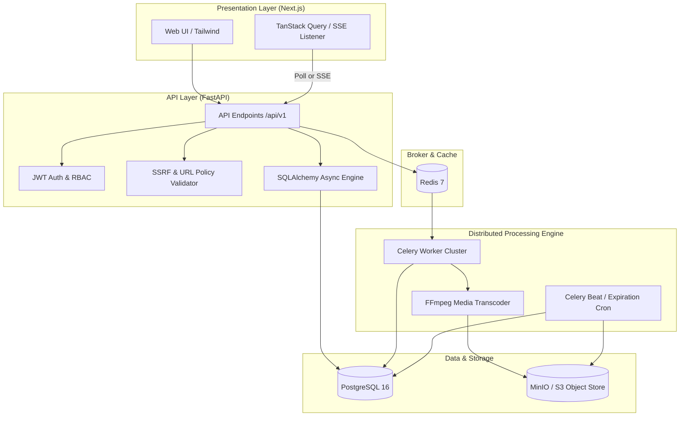
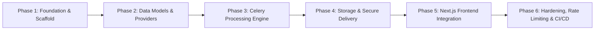

# YouTube Media Downloader — System Implementation & Building Plan

This document establishes the step-by-step engineering build plan for constructing the **YouTube / Authorized Media Downloader Platform** in accordance with the [System Architecture Plan](file:///C:/Users/ptlru/Desktop/FDE/PROJECTS/YT%20downloader/youtube_video_downloader_system_architecture.md).

---

## 1. Executive Summary & Architecture Blueprint

The system is constructed as a **modular monolith** with decoupled asynchronous background workers, designed for resilience, strict SSRF/media security, and high throughput.

### 1.1 Core Technology Stack
- **Backend API**: Python 3.12+, FastAPI, Pydantic v2, SQLAlchemy 2.0 (asyncio + asyncpg)
- **Task Queue & Broker**: Celery + Redis 7
- **Database**: PostgreSQL 16
- **Object Storage**: S3 API (MinIO for local dev, AWS S3 for production)
- **Media Engine**: FFmpeg 6.x+ (isolated within worker containers)
- **Frontend**: Next.js 14+ (App Router, TypeScript, Tailwind CSS, TanStack Query, Zustand, Lucide Icons)
- **DevOps / Orchestration**: Docker Compose, GitHub Actions, AWS ECS Fargate ready

### 1.2 Component Interaction Overview



---

## 2. Target Project Directory Structure

```text
yt-downloader/
├── docker-compose.yml
├── .env.example
├── .gitignore
├── README.md
├── BUILD_PLAN.md
│
├── backend/
│   ├── Dockerfile
│   ├── requirements.txt
│   ├── alembic.ini
│   ├── alembic/
│   │   ├── env.py
│   │   └── versions/
│   ├── tests/
│   │   ├── conftest.py
│   │   ├── unit/
│   │   │   ├── test_url_validator.py
│   │   │   └── test_security.py
│   │   └── integration/
│   │       ├── test_api_auth.py
│   │       ├── test_api_videos.py
│   │       └── test_api_downloads.py
│   └── app/
│       ├── __init__.py
│       ├── main.py
│       ├── config.py
│       ├── api/
│       │   ├── __init__.py
│       │   ├── deps.py
│       │   └── v1/
│       │       ├── __init__.py
│       │       ├── router.py
│       │       ├── auth.py
│       │       ├── videos.py
│       │       ├── downloads.py
│       │       └── history.py
│       ├── core/
│       │   ├── __init__.py
│       │   ├── security.py
│       │   ├── exceptions.py
│       │   ├── logging.py
│       │   └── rate_limiter.py
│       ├── db/
│       │   ├── __init__.py
│       │   ├── session.py
│       │   └── base.py
│       ├── models/
│       │   ├── __init__.py
│       │   ├── user.py
│       │   ├── media.py
│       │   ├── download.py
│       │   └── history.py
│       ├── schemas/
│       │   ├── __init__.py
│       │   ├── user.py
│       │   ├── video.py
│       │   ├── download.py
│       │   └── common.py
│       ├── repositories/
│       │   ├── __init__.py
│       │   ├── base.py
│       │   ├── user_repository.py
│       │   ├── media_repository.py
│       │   └── download_repository.py
│       ├── services/
│       │   ├── __init__.py
│       │   ├── url_validator.py
│       │   ├── metadata_service.py
│       │   ├── format_service.py
│       │   ├── download_service.py
│       │   ├── storage_service.py
│       │   └── providers/
│       │       ├── __init__.py
│       │       ├── base.py
│       │       ├── youtube_provider.py
│       │       └── direct_provider.py
│       └── workers/
│           ├── __init__.py
│           ├── celery_app.py
│           ├── download_worker.py
│           └── cleanup_worker.py
│
└── frontend/
    ├── Dockerfile
    ├── package.json
    ├── tsconfig.json
    ├── tailwind.config.ts
    ├── next.config.mjs
    ├── src/
    │   ├── app/
    │   │   ├── layout.tsx
    │   │   ├── page.tsx
    │   │   ├── login/page.tsx
    │   │   ├── register/page.tsx
    │   │   ├── dashboard/page.tsx
    │   │   └── history/page.tsx
    │   ├── components/
    │   │   ├── layout/
    │   │   │   ├── Navbar.tsx
    │   │   │   ├── Sidebar.tsx
    │   │   │   └── Footer.tsx
    │   │   ├── video/
    │   │   │   ├── URLInput.tsx
    │   │   │   ├── VideoPreview.tsx
    │   │   │   ├── FormatSelector.tsx
    │   │   │   └── DownloadButton.tsx
    │   │   ├── downloads/
    │   │   │   ├── DownloadCard.tsx
    │   │   │   ├── ProgressBar.tsx
    │   │   │   ├── DownloadQueue.tsx
    │   │   │   └── DownloadHistoryTable.tsx
    │   │   └── common/
    │   │       ├── Loader.tsx
    │   │       ├── ErrorAlert.tsx
    │   │       └── Badge.tsx
    │   ├── hooks/
    │   │   ├── useAuth.ts
    │   │   ├── useVideoMetadata.ts
    │   │   └── useDownloadJob.ts
    │   ├── lib/
    │   │   ├── api-client.ts
    │   │   ├── auth-context.tsx
    │   │   └── utils.ts
    │   └── types/
    │       ├── auth.ts
    │       ├── video.ts
    │       └── download.ts
```

---

## 3. Phased Implementation Roadmap

The building plan is structured into **6 sequential phases**. Each phase contains strict deliverables and acceptance criteria.



---

### Phase 1 — Foundation & Dockerized Infrastructure Scaffold [COMPLETED]

**Objective**: Establish reproducible development environment, core databases, and API boilerplate.

#### Tasks:
- [x] **Container Orchestration (`docker-compose.yml`)**:
   - PostgreSQL 16 container with persistent volume and health check.
   - Redis 7 container (configured with AOF persistence).
   - MinIO S3 object store container with default bucket creation hook.
   - Backend API container (hot reloading with `uvicorn`).
   - Celery worker container (mounted with FFmpeg).
- [x] **Backend Config & Dependencies (`backend/`)**:
   - `requirements.txt`: `fastapi`, `uvicorn`, `pydantic-settings`, `sqlalchemy[asyncio]`, `asyncpg`, `alembic`, `celery[redis]`, `redis`, `boto3`, `aioboto3`, `bcrypt`, `python-jose`, `httpx`, `pytest`, `pytest-asyncio`, `email-validator`.
   - `app/config.py`: Strong typing for settings (database URLs, Redis URLs, S3 credentials, JWT secrets, CORS allowlist) using `pydantic-settings`.
   - Logging configuration (`app/core/logging.py`) with JSON structured logs.
- [x] **Database Foundation**:
   - SQLAlchemy 2.0 Async Session factory (`app/db/session.py`).
   - Base declarative model with UUID primary keys and standard timestamps (`created_at`, `updated_at`).
   - Alembic initialization (`alembic/`) and automated migration configuration (`alembic.ini`, `backend/alembic/env.py`).
- [x] **Authentication & Security Core**:
   - Bcrypt password hashing and verification.
   - JWT access token generation and validation (`app/core/security.py`).
   - FastAPI dependencies: `get_current_user`, `get_current_active_user`, `require_role`.
   - Auth endpoints: `POST /api/v1/auth/register`, `POST /api/v1/auth/login`, `GET /api/v1/auth/me`, `GET /api/v1/users/me`.
- [x] **Automated Tests**:
   - 6/6 tests passing in `backend/tests/` (`test_api_auth.py`, `test_security.py`).

**Phase 1 Milestone Deliverable**:
- Running `docker compose up` starts Postgres, Redis, MinIO, and FastAPI.
- Alembic runs initial migrations successfully (`fae4fb33bd7b_create_users_table.py`).
- User registration, login, and `/me` endpoints verified with automated integration tests.

---

### Phase 2 — Data Models, Validation & Provider Integration

**Objective**: Construct relational schemas and secure media provider abstraction.

#### Tasks:
1. **Relational Models (`app/models/`)**:
   - `User`: `id (UUID)`, `email (Unique)`, `password_hash`, `role (enum: user, admin)`, `is_active`, `created_at`.
   - `Media`: `id (UUID)`, `source_url (Text)`, `title`, `thumbnail_url`, `duration (int seconds)`, `provider (enum: youtube, licensed, direct)`, `created_at`.
   - `Download`: `id (UUID)`, `user_id (FK)`, `media_id (FK)`, `status (enum: queued, processing, uploading, completed, failed, expired, cancelled)`, `format (mp4, webm, mp3)`, `resolution (360p, 480p, 720p, 1080p, audio_only)`, `progress (int 0-100)`, `file_key (text)`, `file_size (bigint)`, `error_message`, `expires_at`, `created_at`.
   - `DownloadHistory`: `id (UUID)`, `user_id (FK)`, `download_id (FK)`, `downloaded_at`, `ip_hash`.
2. **SSRF-Safe URL Validation Service (`app/services/url_validator.py`)**:
   - Regex validation of URL structure.
   - Provider domain allowlisting (e.g., `youtube.com`, `youtu.be`, allowed licensed CDNs).
   - DNS resolution inspection: Resolves host before fetching; rejects loopback (`127.0.0.0/8`), private networks (`10.0.0.0/8`, `172.16.0.0/12`, `192.168.0.0/16`), cloud metadata addresses (`169.254.169.254`), and IPv6 equivalents.
3. **Media Provider Service Layer (`app/services/providers/`)**:
   - `BaseMediaProvider` abstract interface: `extract_metadata(url) -> MediaMetadataResponse`, `verify_authorization(url, user) -> bool`.
   - `YouTubeProvider`: Metadata retrieval using YouTube Data API or authorized OEM/partner hooks.
   - `MockProvider`: Controlled test fixture provider returning mock formats/video buffers without network calls.
4. **Metadata & Format Endpoints**:
   - `POST /api/v1/videos/metadata`: Validates input URL, invokes provider, persists or fetches cached `Media` row, returns available formats and quality tiers.
   - `GET /api/v1/videos/{id}`: Returns cached media details.

**Phase 2 Milestone Deliverable**:
- Database migration committed with indexes on `user_id`, `status`, `expires_at`.
- Unit tests covering SSRF validator rejecting malicious IPs and unapproved domains.
- Metadata endpoint returns parsed formats and durations.

---

### Phase 3 — Asynchronous Job Processing Engine (Celery + FFmpeg)

**Objective**: Offload media download and transformation to background workers with real-time state tracking.

#### Tasks:
1. **Celery Worker Configuration (`app/workers/celery_app.py`)**:
   - Connection to Redis broker with separate queues:
     - `media-processing`: Heavy media retrieval and FFmpeg tasks.
     - `metadata-fetch`: Fast external API calls.
     - `housekeeping`: File expiry cleanup.
   - Task settings: `task_acks_late=True`, `task_reject_on_worker_lost=True`, concurrency limits per worker container.
2. **Download Task Execution (`app/workers/download_worker.py`)**:
   - Step 1: Update status to `processing`, set `progress = 10`.
   - Step 2: Stream media from authorized provider into temporary scratch disk (`/tmp/media_jobs/{job_id}/`).
   - Step 3: FFmpeg processing via `ffmpeg-python` or asynchronous subprocess:
     - Output formatting (MP4 container with H.264/AAC, WebM with VP9/Opus, or MP3 audio extraction).
     - Progress extraction from FFmpeg `stderr` parsing `time=` and duration to update Redis progress counter (10% to 80%).
   - Step 4: Validate output file size, headers, and media integrity using `ffprobe`.
   - Step 5: Hand off file to `StorageService` (upload to S3/MinIO), update status to `completed`, progress to 100%, record `file_size` and `expires_at` (now + 24 hours).
   - Failure Handling: Wrap in `try/except`, sanitize errors (prevent exposing internal paths), update status to `failed`.
3. **Download Job API Endpoints (`app/api/v1/downloads.py`)**:
   - `POST /api/v1/downloads`: Validates format against allowed media options, checks user quota, creates DB record with `status=queued`, dispatches Celery task, returns `202 Accepted` with `job_id`.
   - `GET /api/v1/downloads/{job_id}`: Returns status, progress integer, duration, file metadata.
   - `GET /api/v1/downloads/{job_id}/events` (SSE): Server-Sent Events streaming live job progress directly from Redis pub/sub.
   - `DELETE /api/v1/downloads/{job_id}`: Revokes Celery task and deletes pending files.

**Phase 3 Milestone Deliverable**:
- Submitting a download request immediately enqueues Celery task.
- Celery worker processes job, drives progress updates from 0 to 100%, and updates Postgres.
- Failure states gracefully recorded with safe error messages.

---

### Phase 4 — Storage Service & Secure Asset Delivery

**Objective**: Secure multi-part S3 storage and short-lived signed download links.

#### Tasks:
1. **Object Storage Service (`app/services/storage_service.py`)**:
   - S3 client wrapper supporting both AWS S3 and MinIO with multipart upload support for large assets (>50MB).
   - Deterministic and collision-free object key scheme: `downloads/{user_id}/{year}/{month}/{job_id}.{ext}`.
   - Private bucket policy enforcement (no public read permissions allowed).
2. **Presigned URL Generator**:
   - Endpoint: `GET /api/v1/downloads/{id}/file`.
   - Verification: Checks `user_id == current_user.id`, verifies `status == completed`, verifies `expires_at > now()`.
   - Generates AWS S3 / MinIO Presigned GET URL with strict TTL (default 15 minutes).
   - Inserts audit record into `DownloadHistory` with hashed client IP.
3. **Automated Expiry & Cleanup Worker (`app/workers/cleanup_worker.py`)**:
   - Celery Beat scheduled task executing every 15 minutes.
   - Queries `Download` records where `expires_at <= now()` and `status == completed`.
   - Deletes underlying object from S3/MinIO storage.
   - Updates status to `expired` and clears `file_key`.
   - Cleans orphaned temporary files in worker container scratch volumes.

**Phase 4 Milestone Deliverable**:
- Processed files reliably stored in MinIO bucket.
- User can obtain a 15-minute signed URL to download their file directly.
- Expired files are automatically purged by Celery Beat without orphaned storage leaks.

---

### Phase 5 — Modern Next.js Frontend Integration

**Objective**: Build a responsive user experience with real-time feedback.

#### Tasks:
1. **Project Scaffolding (`frontend/`)**:
   - Next.js 14+ App Router with TypeScript and Tailwind CSS.
   - API client wrapper using Axios with request interceptors for JWT token injection and automatic 401 refresh handling.
   - Global notification toaster and modal system.
2. **Core Pages & Features**:
   - **Authentication Pages (`/login`, `/register`)**: Form validation with `react-hook-form` and `zod`.
   - **Home / Downloader Page (`/`)**:
     - `URLInput.tsx`: Input field with debounced syntax validation and "Inspect Media" trigger.
     - `VideoPreview.tsx`: Displays thumbnail, title, video duration, and provider tag.
     - `FormatSelector.tsx`: Interactive grid/pills to select resolution (1080p, 720p, 480p) or Audio Only (MP3).
     - `DownloadButton.tsx`: Initiates job and redirects/opens active download drawer.
   - **Active Downloads Dashboard (`/dashboard`)**:
     - `DownloadQueue.tsx`: Renders cards for queued and processing tasks.
     - `ProgressBar.tsx`: Smooth animated progress bar hooked into TanStack Query polling (1.5s interval) or SSE.
     - Direct "Save to Disk" button when status reaches `completed`.
   - **Download History (`/history`)**:
     - Paginated data table showing previous downloads, formats, file sizes, creation timestamps, and re-download or expired indicators.

**Phase 5 Milestone Deliverable**:
- End-to-end interactive workflow: Paste URL -> Preview metadata -> Select 720p MP4 -> Click Download -> Observe real-time progress bar -> Click Download Link -> File downloaded to browser.

---

### Phase 6 — Hardening, Rate Limiting, Testing & CI/CD

**Objective**: Ensure system stability, resource bounds, security posture, and deployment pipelines.

#### Tasks:
1. **Rate Limiting & Quotas (`app/core/rate_limiter.py`)**:
   - Redis-backed sliding window rate limiter (e.g., max 10 metadata inspections/min, max 5 downloads/hour for free users).
   - Maximum concurrent job restriction per user (default 2 active jobs).
   - Duration limit cap (e.g., maximum 30 minutes for media).
2. **Testing Suite Execution**:
   - Unit tests: URL validation, SSRF boundary tests, JWT expiration, Pydantic schemas.
   - Integration tests: Complete API route coverage with Testcontainers/PostgreSQL fixture.
   - Worker mock tests: Verification of transcode logic with mock media fixtures.
   - End-to-end smoke test using Playwright.
3. **CI/CD Pipeline (`.github/workflows/ci.yml`)**:
   - Automated linting & formatting (`ruff` for Python, `eslint` / `prettier` for Next.js).
   - Static type checking (`mypy` for backend, `tsc` for frontend).
   - Test execution with coverage gate (>80%).
   - Multi-stage Docker image builds with minimal rootless images.
4. **Production Configuration**:
   - `nginx` reverse proxy configuration template.
   - Health check endpoints: `/healthz` for API, worker liveness checks.
   - Prometheus metrics endpoint for request durations and queue length.

**Phase 6 Milestone Deliverable**:
- All tests green in CI pipeline.
- Rate limiting blocks requests exceeding quota.
- Clean Docker build outputs with production-grade security defaults.

---

## 4. Work Breakdown Structure (WBS) & Sprint Matrix

| Sprint | Focus Area | Key Deliverables | Estimated Days |
|---|---|---|---|
| **Sprint 1** | Scaffolding & Core Auth | Docker Compose, FastAPI boilerplate, DB session, User models, JWT Auth | 3 - 4 days |
| **Sprint 2** | Schemas & Provider Layer | Database models, Alembic migrations, SSRF validator, Metadata service | 3 - 4 days |
| **Sprint 3** | Celery & Media Pipeline | Celery configuration, Redis broker, FFmpeg worker, Progress polling/SSE | 4 - 5 days |
| **Sprint 4** | Storage & Expiration | MinIO/S3 integration, presigned URLs, Celery Beat file expiration job | 2 - 3 days |
| **Sprint 5** | Frontend Development | Next.js layout, URL input, Video preview, Format selection, Progress cards | 4 - 5 days |
| **Sprint 6** | Hardening & CI/CD | Rate limiting, Prometheus metrics, Pytest suite, GitHub Actions CI | 3 - 4 days |

---

## 5. Definition of Done (DoD) Checklist

- [ ] Docker Compose boots all services cleanly (`postgres`, `redis`, `minio`, `backend`, `worker`, `frontend`).
- [ ] Non-whitelisted domains and private IP ranges are rejected by SSRF guard.
- [ ] Users can register, log in, and view only their own downloads.
- [ ] Video processing occurs strictly in Celery workers, never blocking FastAPI event loop.
- [ ] Real-time progress updates are accurately reflected in the UI.
- [ ] Completed media files are stored in private S3 buckets and accessed solely via short-lived signed URLs.
- [ ] Expired files are reliably deleted from storage and marked in the database.
- [ ] All unit, integration, and security tests pass with >80% code coverage.
