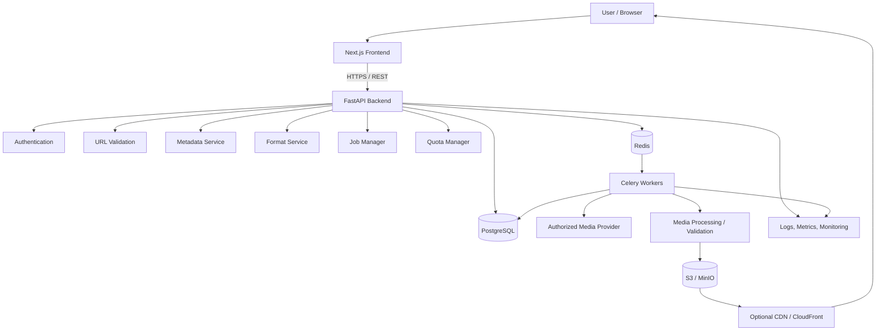
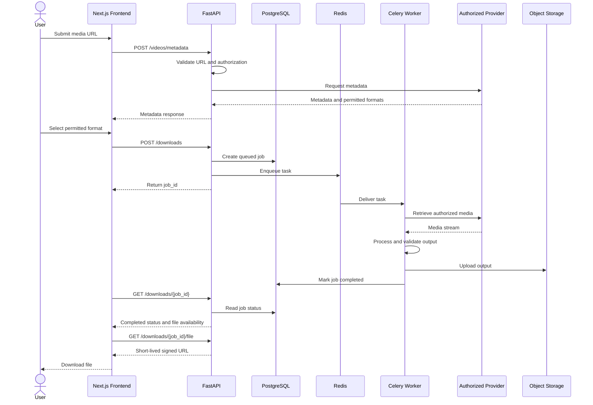
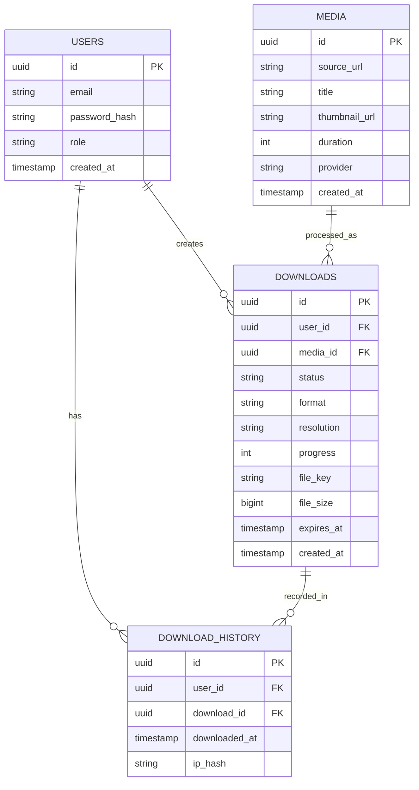
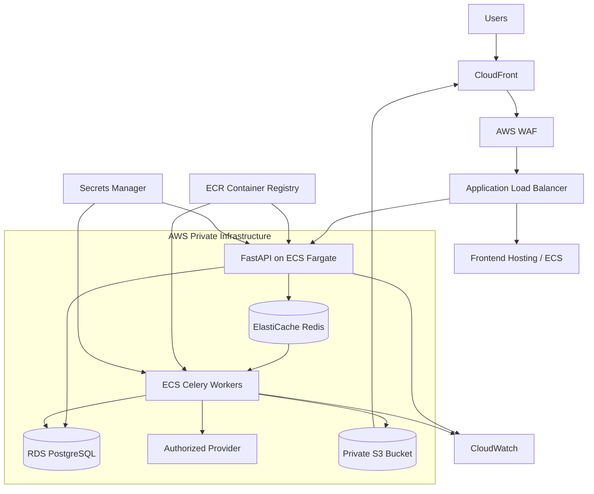
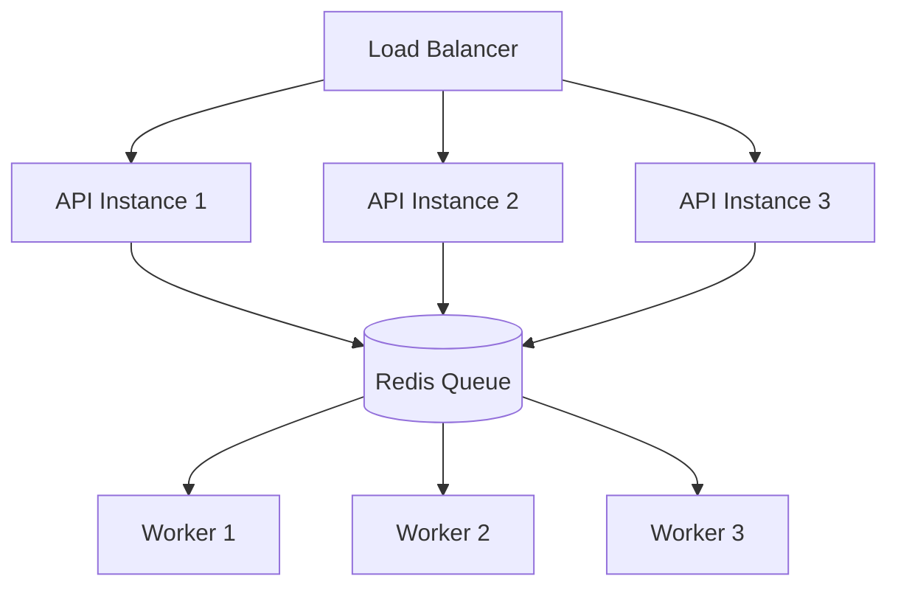
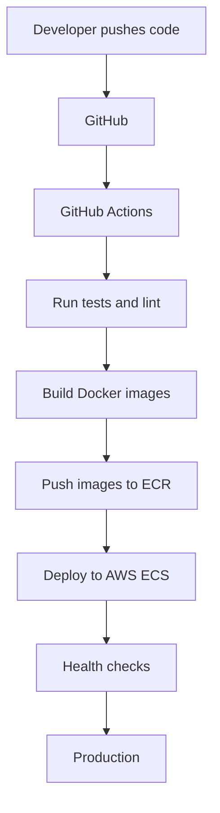

# YouTube Video Downloader — System Architecture Plan

> **Project goal:** Build a scalable, secure, asynchronous media-processing platform with a modern frontend, Python backend, background workers, storage management, and download tracking.
>
> **Important scope and compliance note:** The system should process only media the user owns or is authorized to download, such as user-uploaded videos, licensed media, or content obtained through an authorized provider workflow. It must not bypass YouTube access controls, DRM, or download restrictions. YouTube Data API access does not itself grant permission to download video files.

---

## 1. Project Overview

The application accepts an authorized media URL or source, validates it, retrieves metadata, presents permitted formats, processes a job asynchronously, stores the resulting file securely, and provides a temporary download link.

### Core functionality

- Accept a video URL or authorized media source.
- Validate the URL, provider, and download authorization.
- Retrieve title, thumbnail, duration, and available formats.
- Allow selection of permitted quality and output format.
- Process jobs asynchronously.
- Display job progress and status.
- Store completed files securely.
- Provide download history and automatic file expiration.
- Enforce rate limits, quotas, and resource limits.

### Recommended technology stack

| Layer | Recommended technology |
|---|---|
| Frontend | Next.js + TypeScript |
| Styling | Tailwind CSS |
| Backend API | FastAPI + Python |
| Validation | Pydantic |
| ORM | SQLAlchemy 2.0 |
| Database | PostgreSQL |
| Cache and broker | Redis |
| Background jobs | Celery |
| Media processing | FFmpeg, only for authorized media |
| Object storage | S3-compatible storage (MinIO locally, AWS S3 in production) |
| Authentication | JWT or OAuth |
| Containers | Docker |
| Testing | Pytest, HTTPX, Playwright |
| Deployment | AWS ECS or Docker-based VPS |

---

## 2. Functional Requirements

Divide the application into six major modules.

| Module | Responsibilities |
|---|---|
| URL management | Accept and validate source URLs |
| Metadata service | Retrieve authorized media metadata |
| Format selection | Show available, permitted formats |
| Processing engine | Retrieve and process authorized media |
| Storage service | Store and serve completed files |
| User management | Authentication, history, and quotas |

### Initial feature set

1. Video URL input.
2. Video preview and metadata.
3. Format selection: MP4, WebM, and MP3 where authorized.
4. Quality selection: available resolutions such as 360p, 480p, 720p, or 1080p.
5. Asynchronous processing.
6. Job progress and status.
7. Download history.
8. Automatic file expiration.
9. Rate limiting and usage quotas.
10. Error handling and retry mechanism.

> Available formats and resolutions depend on the source provider's authorization and the media formats actually offered.

---

## 3. High-Level System Architecture

### 3.1 Architecture diagram



### 3.2 Architecture layers

| Layer | Technology | Purpose |
|---|---|---|
| Presentation | Next.js | User interface |
| API | FastAPI | Application logic |
| Authentication | JWT / OAuth | User authentication |
| Database | PostgreSQL | Persistent records |
| Cache | Redis | Temporary data and broker |
| Queue | Celery | Background jobs |
| Processing | Python workers | Authorized media processing |
| Storage | AWS S3 / MinIO | Media files |
| CDN | CloudFront (optional) | Efficient file delivery |
| Monitoring | Prometheus + Grafana / CloudWatch | Observability |

### 3.3 Architectural style

Start with a **modular monolith**, not microservices.

A modular FastAPI application is easier to develop, test, deploy, and maintain. Keep domain responsibilities separated into modules. Split components into independently deployed services only when scale, team boundaries, or operational requirements justify it.

---

## 4. Detailed Backend Architecture

### 4.1 Recommended backend folder structure

```text
video-downloader/
│
├── backend/
│   ├── app/
│   │   ├── main.py
│   │   ├── config.py
│   │   │
│   │   ├── api/
│   │   │   └── v1/
│   │   │       ├── auth.py
│   │   │       ├── videos.py
│   │   │       ├── downloads.py
│   │   │       └── history.py
│   │   │
│   │   ├── core/
│   │   │   ├── security.py
│   │   │   ├── exceptions.py
│   │   │   └── logging.py
│   │   │
│   │   ├── models/
│   │   │   ├── user.py
│   │   │   ├── download.py
│   │   │   └── media.py
│   │   │
│   │   ├── schemas/
│   │   │   ├── user.py
│   │   │   ├── video.py
│   │   │   └── download.py
│   │   │
│   │   ├── services/
│   │   │   ├── url_validator.py
│   │   │   ├── metadata_service.py
│   │   │   ├── format_service.py
│   │   │   ├── download_service.py
│   │   │   └── storage_service.py
│   │   │
│   │   ├── workers/
│   │   │   ├── celery_app.py
│   │   │   └── download_worker.py
│   │   │
│   │   ├── repositories/
│   │   │   ├── user_repository.py
│   │   │   └── download_repository.py
│   │   │
│   │   └── db/
│   │       ├── session.py
│   │       └── base.py
│   │
│   ├── tests/
│   ├── alembic/
│   ├── Dockerfile
│   └── requirements.txt
│
├── frontend/
│   ├── src/
│   │   ├── app/
│   │   ├── components/
│   │   ├── hooks/
│   │   ├── services/
│   │   ├── types/
│   │   └── lib/
│   └── package.json
│
├── docker-compose.yml
├── .env.example
└── README.md
```

### 4.2 Backend module responsibilities

| Module | Responsibility |
|---|---|
| `url_validator.py` | Validate URL structure, allowed provider, and source policy |
| `metadata_service.py` | Retrieve title, thumbnail, duration, and metadata |
| `format_service.py` | Return formats and resolutions the provider permits |
| `download_service.py` | Create and coordinate processing jobs |
| `download_worker.py` | Execute background processing |
| `storage_service.py` | Upload, retrieve, and delete stored files |
| `download_repository.py` | Database operations for download jobs |
| `security.py` | Authentication, authorization, and access control |

**Design principle:** Keep business logic out of API routes. Routes should validate requests, invoke services, and return responses. Use repository classes or a clearly defined data-access layer for database operations.

---

## 5. Complete Application Workflow

### 5.1 Workflow overview



### 5.2 Step 1 — URL submission

Example request:

```http
POST /api/v1/videos/metadata
Content-Type: application/json
Authorization: Bearer <access_token>
```

```json
{
  "url": "https://example.com/authorized-media/123"
}
```

Backend responsibilities:

1. Validate URL syntax.
2. Check the provider against an explicit allowlist.
3. Verify access and download authorization using the provider's supported method.
4. Retrieve metadata from the authorized provider.
5. Return metadata and permitted format options.

Illustrative response:

```json
{
  "media_id": "media_123",
  "title": "Sample Video",
  "thumbnail": "https://example.com/image.jpg",
  "duration": 600,
  "available_formats": [
    {
      "format": "mp4",
      "resolution": "720p"
    },
    {
      "format": "webm",
      "resolution": "1080p"
    }
  ]
}
```

The response values above are examples, not a guarantee that a particular provider offers those formats.

### 5.3 Step 2 — Format selection

The user selects:

- Video or audio output.
- An available resolution.
- An output format.
- A destination or storage preference, if applicable.

The backend must independently verify that the selected format is available and permitted. Never trust frontend-supplied format options.

### 5.4 Step 3 — Create a processing job

Example request:

```http
POST /api/v1/downloads
Content-Type: application/json
Authorization: Bearer <access_token>
```

```json
{
  "media_id": "media_123",
  "format": "mp4",
  "resolution": "720p"
}
```

Backend operations:

1. Authenticate the user.
2. Check usage quota and rate limits.
3. Verify media authorization.
4. Create a database record.
5. Publish a task to Redis/Celery.
6. Return a job ID.

Example response:

```json
{
  "job_id": "job_abc123",
  "status": "queued",
  "message": "Processing request"
}
```

### 5.5 Step 4 — Background processing

Do not perform large media processing operations directly inside FastAPI request handlers.

```text
FastAPI
   |
   v
Create Processing Job
   |
   v
Redis / Celery Queue
   |
   v
Celery Worker
   |
   v
Authorized Media Provider
   |
   v
Process and Validate Media
   |
   v
Upload to Object Storage
   |
   v
Update Database
```

Worker responsibilities:

- Retrieve authorized media.
- Process the selected format.
- Validate the output file.
- Upload the output to storage.
- Update job status.
- Handle failures and retries.

### 5.6 Step 5 — Job status tracking

Example request:

```http
GET /api/v1/downloads/job_abc123
Authorization: Bearer <access_token>
```

Example response:

```json
{
  "job_id": "job_abc123",
  "status": "processing",
  "progress": 65,
  "created_at": "2026-11-02T15:30:00Z"
}
```

Recommended states:

| State | Meaning |
|---|---|
| `queued` | Job is waiting for a worker |
| `processing` | Media retrieval or processing is underway |
| `uploading` | Output is being stored |
| `completed` | File is ready |
| `failed` | Processing failed |
| `expired` | Temporary file has expired |
| `cancelled` | User or system cancelled the job |

Use Server-Sent Events (SSE) or WebSockets for real-time progress when needed. Polling is acceptable for an initial MVP. Backend job status should remain the source of truth.

---

## 6. Database Architecture

Use PostgreSQL with SQLAlchemy 2.0 and Alembic migrations.

### 6.1 Users table

| Column | Type | Description |
|---|---|---|
| `id` | UUID | Primary key |
| `email` | VARCHAR | User email |
| `password_hash` | VARCHAR | Secure password hash |
| `role` | VARCHAR | User role |
| `created_at` | TIMESTAMP | Registration time |

### 6.2 Media table

| Column | Type | Description |
|---|---|---|
| `id` | UUID | Primary key |
| `source_url` | TEXT | Original media URL |
| `title` | VARCHAR | Media title |
| `thumbnail_url` | TEXT | Thumbnail |
| `duration` | INTEGER | Duration in seconds |
| `provider` | VARCHAR | Source provider |
| `created_at` | TIMESTAMP | Creation time |

Avoid storing sensitive provider credentials or unnecessary source data in this table. Consider URL normalization and retention policies.

### 6.3 Downloads table

| Column | Type | Description |
|---|---|---|
| `id` | UUID | Primary key |
| `user_id` | UUID | Foreign key to users |
| `media_id` | UUID | Foreign key to media |
| `status` | VARCHAR | Job status |
| `format` | VARCHAR | Output format |
| `resolution` | VARCHAR | Selected quality |
| `progress` | INTEGER | Processing progress |
| `file_key` | TEXT | Object storage key |
| `file_size` | BIGINT | File size in bytes |
| `error_message` | TEXT | Safe error details |
| `expires_at` | TIMESTAMP | Expiration time |
| `created_at` | TIMESTAMP | Job creation time |

### 6.4 Download history table

| Column | Type | Description |
|---|---|---|
| `id` | UUID | Primary key |
| `user_id` | UUID | User reference |
| `download_id` | UUID | Download reference |
| `downloaded_at` | TIMESTAMP | Download time |
| `ip_hash` | VARCHAR | Optional privacy-conscious audit identifier |

### 6.5 Database relationships



Add indexes on:

- `downloads.user_id`
- `downloads.status`
- `downloads.created_at`
- `downloads.expires_at`
- `media.provider`

Use database constraints for valid statuses and nonnegative progress. Consider a separate audit-events table if a fuller audit trail is required.

---

## 7. API Design

Use REST API versioning, consistent response schemas, and centralized error handling.

| Method | Endpoint | Purpose |
|---|---|---|
| POST | `/api/v1/auth/register` | Register |
| POST | `/api/v1/auth/login` | Login |
| GET | `/api/v1/users/me` | Get user profile |
| POST | `/api/v1/videos/metadata` | Retrieve metadata |
| GET | `/api/v1/videos/{id}` | Get media details |
| POST | `/api/v1/downloads` | Create processing job |
| GET | `/api/v1/downloads/{id}` | Get job status |
| GET | `/api/v1/downloads` | List user's jobs |
| GET | `/api/v1/downloads/{id}/file` | Obtain download link |
| DELETE | `/api/v1/downloads/{id}` | Cancel/delete job and file |
| GET | `/api/v1/history` | Get download history |

### API design considerations

- Use UUIDs or opaque identifiers for resources.
- Enforce ownership checks on every user-specific resource.
- Return `202 Accepted` when a background job is queued.
- Use consistent error response schemas.
- Validate request bodies with Pydantic.
- Add pagination to job and history endpoints.
- Make job creation idempotent where practical.
- Use short-lived signed URLs for file delivery.
- Never expose storage credentials or permanent public object URLs.

---

## 8. Frontend Architecture

Use Next.js App Router, TypeScript, and Tailwind CSS.

### 8.1 Main application pages

| Page | Responsibilities |
|---|---|
| Home | URL input, metadata preview, format selection |
| Dashboard | Active jobs, progress, completed files |
| History | Previous jobs, timestamps, statuses |
| Settings | Account, preferences, usage limits |
| Login/Register | Authentication |
| Admin (optional) | Operational metrics and user management |

### 8.2 Frontend component structure

```text
components/
│
├── layout/
│   ├── Navbar.tsx
│   ├── Sidebar.tsx
│   └── Footer.tsx
│
├── video/
│   ├── URLInput.tsx
│   ├── VideoPreview.tsx
│   ├── FormatSelector.tsx
│   └── DownloadButton.tsx
│
├── downloads/
│   ├── DownloadCard.tsx
│   ├── ProgressBar.tsx
│   ├── DownloadQueue.tsx
│   └── DownloadHistory.tsx
│
└── common/
    ├── Loader.tsx
    ├── ErrorMessage.tsx
    └── Modal.tsx
```

### 8.3 Frontend state management

| Tool | Purpose |
|---|---|
| TanStack Query | API data fetching, caching, and invalidation |
| Zustand | Local application state |
| React Hook Form | Form handling |
| Zod | Client-side validation |
| SSE / WebSockets | Live job updates |

Keep backend job status as the source of truth. Do not rely only on frontend progress calculations.

---

## 9. Security Architecture

Security is especially important because a URL-processing application can be vulnerable to Server-Side Request Forgery (SSRF), malicious files, unauthorized access, and resource exhaustion.

| Risk | Protection |
|---|---|
| SSRF | Provider allowlist, URL validation, egress restrictions |
| Malicious URLs | Strict source validation |
| Unauthorized access | Authentication and ownership checks |
| Large files | File-size and duration limits |
| Queue abuse | Rate limiting and quotas |
| SQL injection | SQLAlchemy parameterized queries |
| Malicious media | Isolated processing and file validation |
| Storage exposure | Private buckets and signed URLs |
| Resource exhaustion | CPU, memory, and timeout limits |
| Secret exposure | Environment secrets manager |

### 9.1 SSRF prevention

Never allow a backend worker to fetch arbitrary URLs. An attacker could submit URLs targeting internal infrastructure, cloud metadata services, or private network addresses.

Required controls:

1. Allow only explicitly supported provider domains.
2. Reject loopback, private, link-local, and reserved IP ranges.
3. Revalidate DNS resolution and every redirect.
4. Restrict outbound network access at the infrastructure level.
5. Run media workers in isolated containers with no unnecessary network privileges.
6. Limit request size, duration, redirects, and execution time.
7. Avoid accepting arbitrary user-controlled headers or provider credentials.
8. Log security events without exposing secrets.

A URL having a YouTube domain does not establish download authorization. Verify authorization independently through supported workflows.

### 9.2 Authentication and authorization

- Hash passwords using a modern password-hashing algorithm such as Argon2id.
- Use short-lived access tokens and a secure refresh-token strategy.
- Store browser tokens in appropriately protected cookies where practical.
- Enforce resource ownership in every endpoint.
- Apply role-based access control for administrative functions.
- Protect state-changing browser requests against CSRF when cookie authentication is used.

### 9.3 File safety

- Validate file signatures and media metadata, not just extensions.
- Use generated storage keys rather than user-provided filenames.
- Keep buckets private.
- Set file-size and processing-time limits.
- Prevent path traversal.
- Delete temporary files after processing.
- Apply malware scanning where the threat model requires it.

---

## 10. Infrastructure and Deployment Architecture

AWS is a suitable production deployment option.

### 10.1 AWS architecture



### 10.2 AWS service responsibilities

| AWS service | Purpose |
|---|---|
| ECS Fargate | Run FastAPI containers |
| ECS Worker Service | Run Celery workers |
| RDS PostgreSQL | Persistent database |
| ElastiCache Redis | Queue broker and cache |
| S3 | File storage |
| CloudFront | File delivery |
| WAF | Web application protection |
| CloudWatch | Logs and metrics |
| Secrets Manager | Secure credentials |
| ECR | Docker image registry |
| ALB | Application traffic routing |

For development, Docker Compose with PostgreSQL, Redis, FastAPI, and Celery is sufficient.

---

## 11. Scalability Architecture

Design for scaling without prematurely introducing unnecessary complexity.

### 11.1 Horizontal scaling

Instead of relying on one powerful server, add application and worker instances as demand increases.



### 11.2 Queue management

Use separate queues for different workloads.

| Queue | Purpose |
|---|---|
| `metadata` | Metadata retrieval |
| `media` | Authorized media processing |
| `conversion` | Format conversion |
| `cleanup` | Expired-file deletion |

Recommended controls:

- Task timeouts.
- Retry with exponential backoff.
- Idempotency keys.
- Dead-letter handling for repeatedly failing tasks.
- Queue-specific worker concurrency.
- Task cancellation and graceful shutdown.
- Limits on per-user concurrent jobs.

### 11.3 Storage optimization

- Use multipart uploads for large files.
- Keep media in private object storage.
- Generate short-lived signed URLs.
- Automatically delete expired files.
- Apply S3 lifecycle policies.
- Avoid unnecessary duplicate storage.
- Track storage usage per user and overall.

### 11.4 Monitoring

Track:

- Total jobs created.
- Successful and failed jobs.
- Average processing time.
- Queue waiting time.
- Worker CPU and memory.
- Storage consumption.
- API latency and error rate.
- Number of active users.
- Provider failures and throttling.

Recommended tools: Prometheus, Grafana, CloudWatch, and Sentry.

---

## 12. Testing Strategy

Testing should be part of every development phase.

| Testing type | What to test |
|---|---|
| Unit testing | URL validator, services, quotas |
| Integration testing | API + PostgreSQL + Redis |
| Worker testing | Task execution, retries, cancellation |
| API testing | Authentication and responses |
| Security testing | SSRF, IDOR, malicious inputs |
| Load testing | Concurrent jobs and queue capacity |
| End-to-end testing | Complete user workflow |

Recommended libraries and tools:

- **Pytest:** Backend unit and integration tests.
- **HTTPX:** API tests.
- **Testcontainers:** Isolated database and Redis test dependencies.
- **Playwright:** Frontend end-to-end tests.
- **Locust:** Load testing.

Use mocked or controlled authorized media fixtures in automated tests. Do not make tests depend on unauthorized downloads from public platforms.

---

## 13. Development Roadmap

Build the project in six phases.

### Phase 1 — Foundation

Tasks:

- Set up FastAPI and Next.js.
- Configure PostgreSQL.
- Create database models.
- Set up Docker Compose.
- Implement authentication.
- Establish linting, formatting, and testing.

**Deliverable:** Working application foundation.

### Phase 2 — Metadata and source integration

Tasks:

- Build URL validation.
- Integrate an authorized media provider.
- Implement metadata service.
- Implement format selection.
- Add provider error handling.

**Deliverable:** Media preview and format selection.

### Phase 3 — Background processing

Tasks:

- Configure Redis and Celery.
- Build the job manager.
- Implement authorized media-processing workers.
- Implement job state management.
- Add retry and timeout policies.

**Deliverable:** Working asynchronous processing.

### Phase 4 — Storage and frontend

Tasks:

- Integrate S3 or MinIO.
- Implement secure file delivery.
- Build dashboard and progress UI.
- Implement download history.
- Add automatic file expiration.

**Deliverable:** Complete user workflow.

### Phase 5 — Security and optimization

Tasks:

- Add rate limiting.
- Add SSRF protection.
- Implement cleanup jobs.
- Add logging and monitoring.
- Run load and security tests.

**Deliverable:** Production-ready application candidate.

### Phase 6 — Deployment

Tasks:

- Build Docker images.
- Configure AWS infrastructure.
- Set up CI/CD.
- Configure domains and HTTPS.
- Deploy and monitor.
- Test backups and recovery.

**Deliverable:** Live application.

---

## 14. CI/CD and DevOps

Recommended deployment pipeline:



Recommended tools:

| Tool | Purpose |
|---|---|
| GitHub Actions | CI/CD |
| Ruff | Python linting and formatting |
| Mypy | Static type checking |
| Pytest | Backend tests |
| ESLint | Frontend linting |
| Alembic | Database migrations |
| Docker | Reproducible deployment |

Production deployments should use health checks, rolling or blue/green deployment where appropriate, and a tested rollback procedure. Run database migrations as a controlled deployment step.

---

## 15. YouTube-Specific Considerations

There is an important distinction between a generic media-processing application and a tool that downloads directly from YouTube.

| Feature | Recommended implementation |
|---|---|
| YouTube metadata | YouTube Data API, subject to API policies |
| User's own YouTube videos | Authorized creator download/export workflow |
| Arbitrary YouTube video download | Do not implement unauthorized extraction |
| User-uploaded media | Process through your own media pipeline |
| Licensed media | Use provider-authorized download endpoints |
| Audio extraction | Only for authorized media |

For creator-owned content, investigate YouTube Studio downloads and Google Takeout as authorized acquisition methods.

Do not assume that YouTube Data API access grants permission to download the underlying video. Review the applicable YouTube terms, API policies, content licenses, and provider-specific rules before implementation.

---

## 16. Recommended MVP Configuration

Avoid introducing too many services in the first version.

| Component | Selection |
|---|---|
| Frontend | Next.js + TypeScript |
| Styling | Tailwind CSS |
| Backend | FastAPI |
| ORM | SQLAlchemy 2.0 |
| Validation | Pydantic |
| Database | PostgreSQL |
| Queue | Celery |
| Broker | Redis |
| Media processing | FFmpeg |
| Storage | MinIO locally / S3 in production |
| Authentication | JWT or OAuth |
| Containerization | Docker |
| Testing | Pytest + Playwright |
| Deployment | AWS or Docker-based VPS |

### Suggested local development services

```text
Frontend       Next.js
Backend        FastAPI
Database       PostgreSQL
Broker         Redis
Worker         Celery
Object storage MinIO
```

Use Docker Compose to run these dependencies consistently.

---

## 17. Final Architecture Decisions

1. Start with a modular monolith, not microservices.
2. Use FastAPI for business logic and API endpoints.
3. Use Celery for long-running background tasks.
4. Use Redis for task queues and caching.
5. Use PostgreSQL for persistent data.
6. Use S3-compatible storage for large media files.
7. Keep workers separate from API containers.
8. Use signed URLs for secure file delivery.
9. Implement job status tracking from day one.
10. Make media-provider integrations modular.
11. Enforce provider authorization and applicable content policies.
12. Add monitoring, quotas, and cleanup automation before production.

---

## 18. Product Requirements Decisions

Before implementation, finalize the following choices.

### 18.1 Product scope

Choose one:

- Downloader for user-owned, licensed, and authorized videos.
- Multi-platform authorized media downloader.
- Personal media downloader for the user's own content.

### 18.2 Frontend

- Next.js + TypeScript.
- React + Vite.

### 18.3 Backend

- FastAPI + Python.
- Django + Python.
- Node.js + Express.

### 18.4 Deployment

- AWS.
- Docker + VPS.
- Local development initially.

### 18.5 MVP feature checklist

- [ ] Video metadata and preview.
- [ ] Quality and format selection.
- [ ] Live processing progress.
- [ ] User accounts and download history.
- [ ] Audio extraction for authorized media.
- [ ] Batch processing.
- [ ] Admin dashboard and analytics.

### 18.6 Next engineering deliverables

After confirming the product requirements, prepare:

1. Detailed technical design document.
2. Database ERD and SQLAlchemy models.
3. Complete API contracts and Pydantic schemas.
4. Sequence diagrams for key workflows.
5. Docker Compose configuration.
6. Backend and frontend implementation tasks.
7. CI/CD and deployment configuration.
8. Security and testing checklist.

---

## 19. Definition of Done

The MVP can be considered ready for release when:

- [ ] Users can authenticate securely.
- [ ] Only supported and authorized media sources are accepted.
- [ ] Metadata is retrieved and validated.
- [ ] Only permitted formats are offered.
- [ ] Processing runs asynchronously.
- [ ] Job states and errors are recorded correctly.
- [ ] Completed files are stored privately.
- [ ] Download links are short-lived and access-controlled.
- [ ] Users can see their own job history.
- [ ] Expired files are deleted automatically.
- [ ] Rate limits and resource limits are enforced.
- [ ] Security, integration, and end-to-end tests pass.
- [ ] Logs, metrics, health checks, and alerts are configured.
- [ ] Deployment and rollback procedures are documented.

---

**Document status:** Initial system architecture plan  
**Suggested implementation approach:** Modular monolith + asynchronous workers  
**Primary backend:** FastAPI  
**Primary frontend:** Next.js  
**Primary database:** PostgreSQL  
**Primary queue:** Redis + Celery  
**Media scope:** User-owned, licensed, or otherwise authorized media
